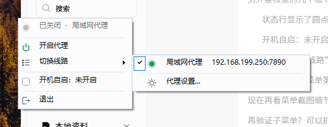
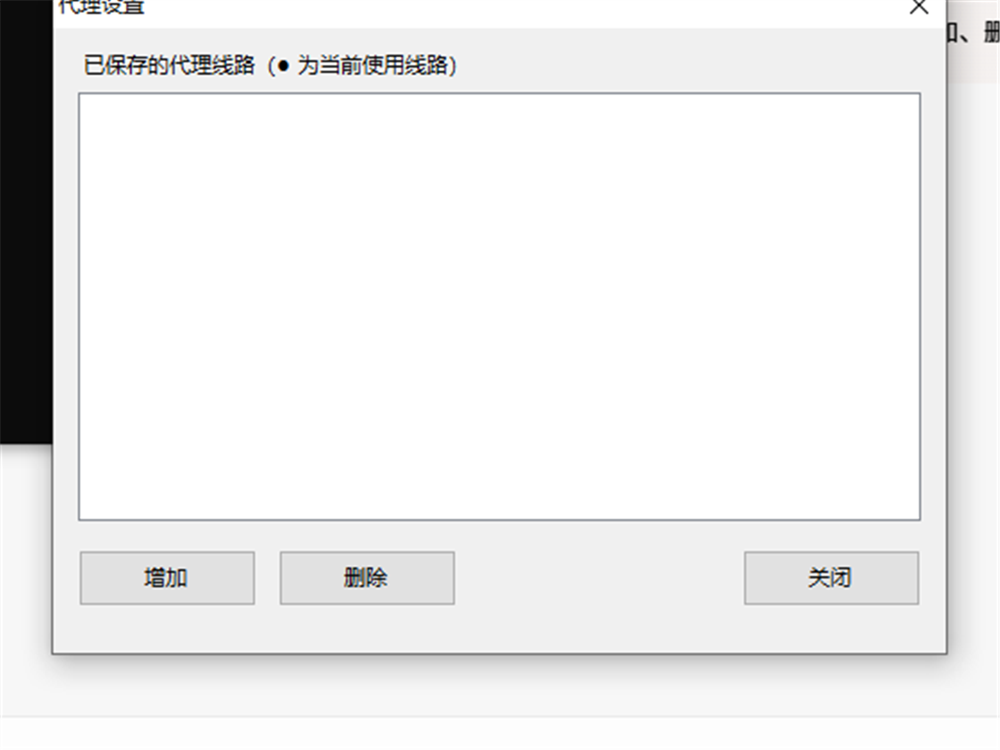

# ProxyTray · 代理开关

> Windows 托盘栏一键开关系统代理的轻量工具。单文件、零依赖、Win7 及以上开箱即用。

ProxyTray 常驻系统托盘，通过一次点击切换 Windows 全局代理（`Internet Settings` 注册表项），并即时通知系统刷新代理配置，无需重启浏览器或其它网络程序。支持多线路快速切换、开机自启、自定义线路增删，全部状态以红绿双色图标直观呈现。

---

## 特性

- **一键开关**：托盘菜单单击即写入 / 撤销系统代理，调用 `InternetSetOption` 立即生效，无需注销或重启。
- **多线路切换**：可保存任意数量的代理线路（`名称 + 地址:端口`），子菜单一键切换，当前线路以绿点标记。
- **状态一眼可辨**：托盘图标 32px 渐变圆徽章，绿色 = 已开启，红色加斜杠 = 已关闭，附带「已开启 / 已关闭 · 线路名」状态行。
- **开机自启**：写入 `HKCU\...\CurrentVersion\Run`，菜单内可直接开关，状态实时回读注册表，不依赖内存缓存。
- **单实例运行**：互斥体 `ProxyTray_v2_single_instance` 保证重复启动时只保留一个托盘图标。
- **零依赖交付**：C# WinForms 单文件源码，`.NET Framework 4.0` 自带编译器即可构建，不打包任何第三方运行时。

## 界面预览

| 托盘菜单 | 代理设置 |
| --- | --- |
|  |  |

| 开启态图标 | 关闭态图标 | 多尺寸 |
| --- | --- | --- |
|  |  |  |

## 快速开始

### 方式一：直接使用 Release

1. 打开 [Releases](../../releases) 页面，下载最新版本的 `ProxyTray.exe`。
2. 放到任意固定目录（建议不要放在临时目录，以免被清理）。
3. 双击运行，图标出现在任务栏通知区域。

> 首次运行 Windows 可能提示「已保护你的电脑」，点击「更多信息 → 仍要运行」即可。程序未做代码签名。

### 方式二：从源码构建

前置条件：Windows 7 SP1 及以上，已安装 .NET Framework 4.0+（Win10/11 自带）。

```powershell
# 在仓库根目录执行
powershell -ExecutionPolicy Bypass -File .\build.ps1
```

产物输出到 `dist\ProxyTray.exe`。

## 使用说明

| 操作 | 说明 |
| --- | --- |
| 开启代理 | 托盘图标右键 → 「开启代理」。写入 `ProxyEnable=1` 与 `ProxyServer=<当前线路地址>` |
| 关闭代理 | 托盘图标右键 → 「关闭代理」。写入 `ProxyEnable=0`，保留 `ProxyServer` 便于下次开启 |
| 切换线路 | 右键 → 「切换线路」子菜单，选中即切换；若代理处于开启状态会同时应用到系统 |
| 新增 / 删除线路 | 子菜单 → 「代理设置...」，填写名称与 `地址:端口`；名称留空时自动使用地址 |
| 开机自启 | 右键 → 「开机自启」，勾选即写入 Run 键，取消即删除 |

### 配置与数据位置

| 内容 | 路径 / 位置 |
| --- | --- |
| 线路列表 | `%LOCALAPPDATA%\ProxyTray\routes.txt`（每行 `名称|地址`） |
| 当前线路 | `%LOCALAPPDATA%\ProxyTray\current.txt` |
| 系统代理 | `HKCU\Software\Microsoft\Windows\CurrentVersion\Internet Settings`（`ProxyEnable` / `ProxyServer`） |
| 开机自启 | `HKCU\Software\Microsoft\Windows\CurrentVersion\Run`，值名 `ProxyTray` |

### 注意事项

- 程序只修改 **当前用户** 的 Internet Settings，不触碰系统级（`HKLM`）配置，无需管理员权限。
- 系统代理对 WinINet 系（IE / Edge / Chrome / 大部分桌面程序）生效；不读取 `HTTP_PROXY` 环境变量的程序（如部分命令行工具、Java 应用）需单独配置。
- 关闭代理后如浏览器仍有缓存连接，刷新页面即可。

## 项目结构

```
ProxyTray/
├─ src/
│  ├─ ProxyTray.cs          主程序（单文件 WinForms，含 UI / 注册表 / 网络通知）
│  └─ tools/
│     └─ MakeIcon.cs        ICO 图标生成器（10 档尺寸逐帧绘制并打包）
├─ assets/
│  └─ proxytray.ico         应用与托盘图标（多尺寸 ICO）
├─ docs/screenshots/        界面与图标预览
├─ build.ps1                一键构建脚本
├─ CHANGELOG.md             版本记录
└─ LICENSE                  MIT
```

### 源码模块划分

`src/ProxyTray.cs` 内部按职责分层：

| 类型 | 职责 |
| --- | --- |
| `Native` | `InternetSetOption` / `InternetQueryOption` 等 P/Invoke 声明 |
| `Config` | 线路读写（`routes.txt` / `current.txt`）、当前线路维护 |
| `Proxy` | 读写注册表代理开关，调用系统接口即时刷新 |
| `AutoStart` | Run 键的写入、删除与真实状态回读 |
| `AddRouteForm` | 新增线路对话框 |
| `SettingsForm` | 线路管理与排序 |
| `TrayApp` | 托盘图标、右键菜单、状态绘制与单实例控制 |

## 兼容性

| 项目 | 说明 |
| --- | --- |
| 操作系统 | Windows 7 SP1 / 8 / 8.1 / 10 / 11 |
| 运行时 | .NET Framework 4.0 及以上 |
| 架构 | AnyCPU（32/64 位系统均可运行） |
| 权限 | 当前用户，无需提权 |

## 常见问题

**Q：改了线路，为什么程序还在走旧代理？**
A：切换线路后若原代理已开启，程序会同时更新 `ProxyServer` 并通知系统；若个别程序仍显示旧连接，刷新或重开该程序即可。

**Q：开机自启菜单显示「未开启」，但我确实设置过？**
A：菜单每次打开都会重新读取 Run 键真实值，显示的即为当前系统状态。若被安全软件拦截，请检查启动项是否被禁用。

**Q：exe 图标不显示 / 变成白纸？**
A：请确认构建时带上了 `/win32icon:assets\proxytray.ico` 参数（`build.ps1` 已包含）。替换 exe 后可执行 `ie4uinit.exe -show` 刷新图标缓存。

## 更新日志

见 [CHANGELOG.md](CHANGELOG.md)。

## 许可证

[MIT](LICENSE)
